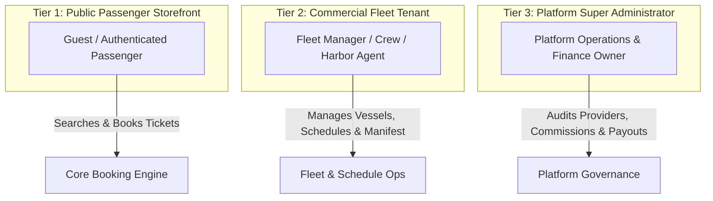
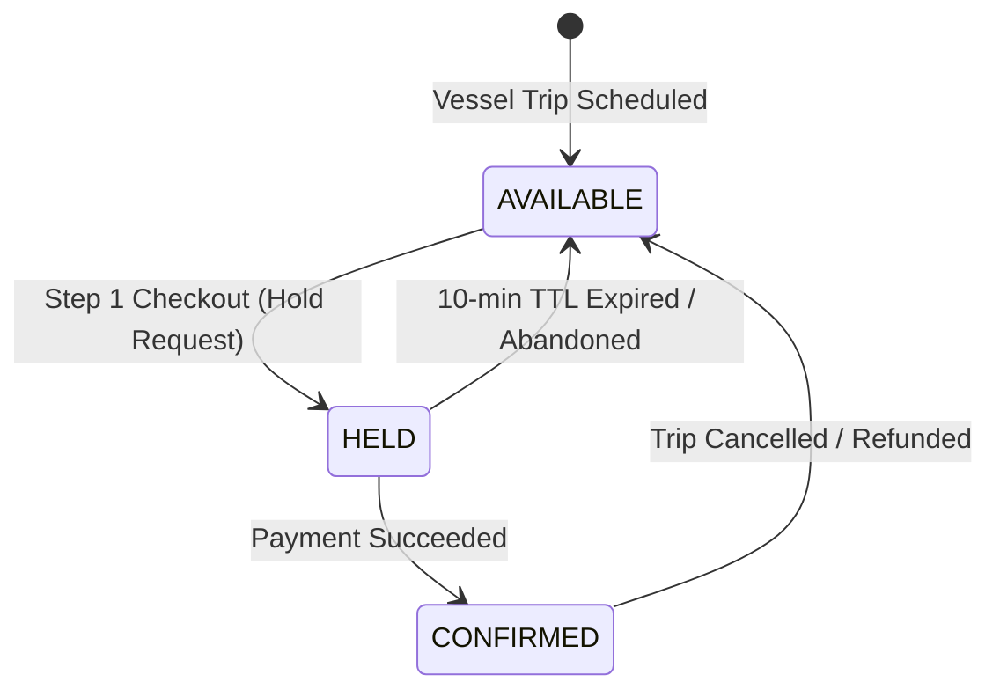
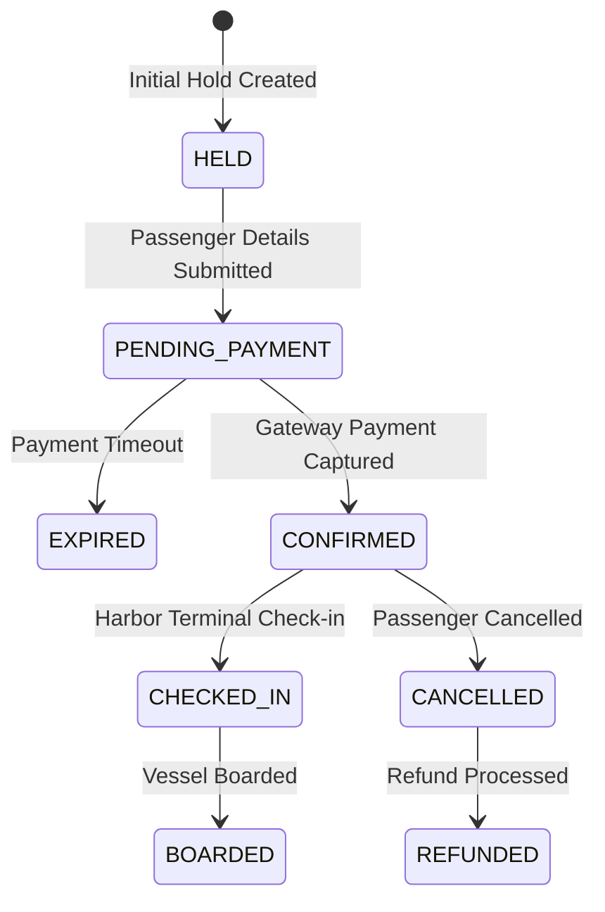
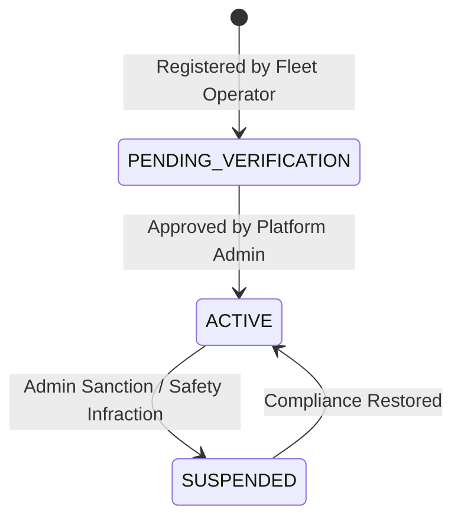

# Architecture Step 1: Business Requirements & Domain Discovery
**Feature:** Ferry Booking Platform (Storefront + Operator Console + Super Admin)  
**Source Specification:** [docs/specs/ferry-booking-ui-spec.md](file:///c:/Users/Khaled/Khaled%20Dask/Backend/nestJs/docs/specs/ferry-booking-ui-spec.md)  
**Status:** Approved & Domain-Locked  
**Date:** 2026-10-13  

---

## 1. Executive Summary & Business Objective
The Ferry Booking Platform is a multi-tier maritime transit marketplace connecting passengers traveling across atolls/island ports with commercial ferry fleet operators, governed by a central platform administration.

The goal of this domain discovery phase is to define the ubiquitous language, business constraints, lifecycles, and core invariants across all three operational tiers before committing to database schemas or endpoint implementations.

---

## 2. System Actors & Operational Tiers

### 1. Passenger (Customer / Guest)
- Can browse popular journeys, search schedules by origin, destination, and travel date.
- Can book tickets without mandatory upfront registration (**Guest Checkout**) using phone and email verification.
- Can manage bookings, view boarding QR codes, or cancel according to cancellation policies via reference lookup (`FG-XXXXXXXX`).

### 2. Fleet Operator (Commercial Tenant)
- Commercial vessel operators (e.g., *Island Ferry Co.*).
- Must have strictly isolated tenant scope: cannot see or modify other operators' vessels, routes, trips, or financial ledgers.
- Manages fleet vessels, publishes departure schedules, and inspects real-time passenger manifests for boarding check-in.

### 3. Platform Super Administrator (Platform Governance)
- Sets global platform commission policies (default: 10% take-rate).
- Reviews and audits commercial operator registrations.
- Holds the executive capability to **Suspend** a provider for safety or compliance infractions, triggering an atomic cascade that stops new ticket sales while safeguarding existing confirmed passengers.

---

## 3. Core Business Workflows

### Workflow A: Trip Discovery & Availability Search
1. Passenger selects `Origin Port`, `Destination Port`, `Travel Date`, and `Passenger Count`.
2. System filters only active routes where `originPortId != destinationPortId`.
3. System matches active, non-suspended operator vessels with available departure slots on that date.
4. Trips with `availableSeats < requestedPassengers` are labeled **Sold Out** and disabled from checkout.

### Workflow B: The 10-Minute Temporary Seat Hold (Concurrency Invariant)
1. When a user selects a trip and advances to Step 2 of checkout, the system generates an ephemeral **Seat Hold Token**.
2. The requested seat inventory is atomically held for **10 minutes (600 seconds)**.
3. If checkout is completed and paid within 10 minutes: seats convert to a **CONFIRMED Booking**.
4. If payment is abandoned or timer expires: the hold lock expires and seats are automatically released back to the general inventory pool.

### Workflow C: Booking Checkout & Passenger Manifest
1. Booker details (Full Name, Contact Email, Contact Phone) are validated.
2. Individual passenger details (Full Name, ID/Passport Number, Passenger Type: `ADULT`, `CHILD`, `INFANT`) are captured.
3. Payment capture occurs via payment gateway (e.g. Stripe).
4. Once payment succeeds, an immutable Booking Reference (`FG-YYYYMMDD-XXX`) is issued and digital tickets are dispatched via email/SMS.

### Workflow D: Manifest Verification & Boarding Check-in
1. At the harbor terminal, operators open the live trip manifest (`Screen 7F`).
2. Passenger status transitions from `CONFIRMED` ➔ `CHECKED_IN` ➔ `BOARDED`.
3. No-show passengers remain auditable for safety compliance.

### Workflow E: Platform Governance & Commission Settlement
1. For every confirmed booking:
   - `Gross Fare` is collected.
   - `Platform Commission` (default 10%, or provider override) is deducted.
   - `Net Provider Remittance` (90%) is logged in the operator payout ledger.
2. Operator suspension immediately revokes trip publishing rights without invalidating prior confirmed passenger itineraries.

---

## 4. Domain Lifecycles & State Machines

### A. Seat Inventory Lifecycle

### B. Booking Master Lifecycle

### C. Provider Commercial Lifecycle

---

## 5. Domain Invariants & Business Rules Matrix

| Invariant # | Domain Rule | Enforcement Layer | Failure Behavior |
|---|---|---|---|
| **INV-1** | `originPortId != destinationPortId` | Search DTO & Catalog Domain | Returns `400 Bad Request` ("Origin and destination cannot be identical"). |
| **INV-2** | `trip.availableSeats >= requestedSeats` | Atomic Hold Transaction | Returns `409 Conflict` ("Seats no longer available"). |
| **INV-3** | `SeatHold TTL == 600s` | Redis TTL / Cache Store | Auto-eviction without database deadlocks. |
| **INV-4** | `Booking.status == CONFIRMED` requires verified `Payment.status == SUCCEEDED` | Checkout Domain Service | Rejects confirmation without valid payment authorization. |
| **INV-5** | `Provider.status == SUSPENDED` blocks all future bookings | Trip Search & Hold Service | Excludes provider trips from search and rejects holds with `403 Forbidden`. |
| **INV-6** | `Operator` can only view own vessels & manifests | Multi-Tenant Scoping | SQL query automatically scoped with `WHERE providerId = req.user.providerId`. |

---

## 6. Resolution of UI Spec Gaps & Decision Checklist

1. **Guest Checkout:** Approved. Phone & Email verification required; optional account setup on confirmation screen.
2. **Round-Trip Data Handling:** Handled as two linked trip legs (`outboundTripId` + `inboundTripId`) within a single unified `Booking`.
3. **Port & Vessel Identity:** Frontend must send relational UUIDs (`portId`, `vesselId`), never arbitrary strings.
4. **Platform Commission:** Dynamic take-rate stored in `PlatformSettings` with per-provider contract override capability.
5. **Cascading Suspension:** Provider suspension deactivates active trip listings instantly while preserving customer refund guarantees.
