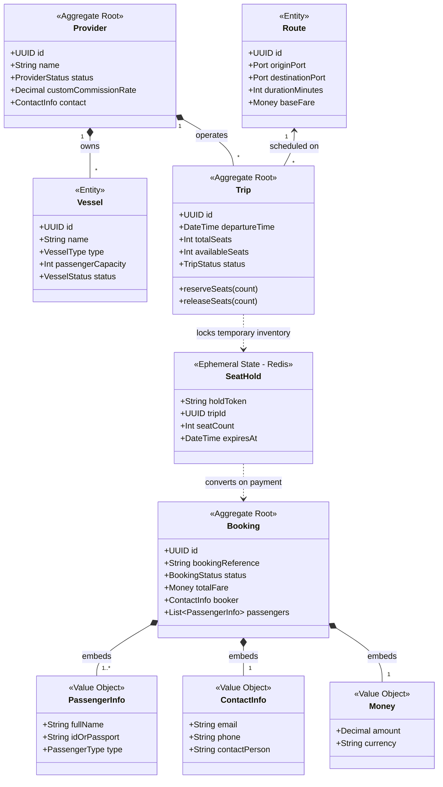
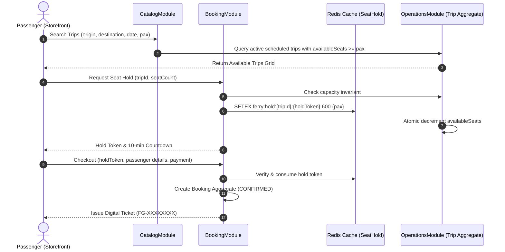

# Architecture Step 2: Domain Model & Architecture Boundaries
**Feature:** Ferry Booking Platform  
**Source Specification:** [docs/specs/ferry-booking-ui-spec.md](file:///c:/Users/Khaled/Khaled%20Dask/Backend/nestJs/docs/specs/ferry-booking-ui-spec.md)  
**Parent Discovery:** [01-domain-discovery.md](file:///c:/Users/Khaled/Khaled%20Dask/Backend/nestJs/docs/architecture/ferry-booking/01-domain-discovery.md)  
**Status:** Approved & Model-Locked  
**Date:** 2026-10-13  

---

## 1. Domain Boundary Philosophy (DDD Standard)
Rather than treating every concept as a heavy relational PostgreSQL table, the domain model is organized according to Domain-Driven Design (DDD) principles:
* **Aggregate Roots** preserve transactional consistency boundaries.
* **Entities** possess unique relational identities and lifecycles.
* **Value Objects** represent immutable descriptive attributes without independent identity.
* **Ephemeral States** represent transient, high-velocity concurrency locks stored in fast cache (Redis TTL), avoiding database lock contention.

---

## 2. Aggregate Roots, Entities & Value Objects Classification



### 1. Aggregate Roots
* **`Trip` (Aggregate Root):**
  - **Boundary:** Enforces seat availability invariants. All seat holds and decrements pass through the `Trip` aggregate to prevent overbooking.
  - **Key Attributes:** `id`, `providerId`, `vesselId`, `routeId`, `departureTime`, `availableSeats`, `status`.
* **`Booking` (Aggregate Root):**
  - **Boundary:** Manages the lifecycle of a passenger's confirmed reservation, ticketing, and line-item passenger details.
  - **Key Attributes:** `id`, `bookingReference`, `outboundTripId`, `inboundTripId?`, `status`, `totalAmount`, `bookerContact`.
* **`Provider` (Aggregate Root):**
  - **Boundary:** Owns commercial fleet data, assigned vessels, and contractual take-rate overrides.

### 2. Entities (Sub-Domain Objects with Identity)
* **`Port`:** Geographic transit terminal (`id`, `name`, `code`, `island`, `atoll`, `coordinates`, `isActive`).
* **`Route`:** Directed connection between two ports (`id`, `originPortId`, `destinationPortId`, `durationMinutes`, `category`).
* **`Vessel`:** Marine craft owned by a provider (`id`, `providerId`, `name`, `type`, `capacity`, `yearBuilt`, `status`).

### 3. Value Objects (Immutable Data Contracts)
* **`PassengerInfo`:** Name, ID/Passport, Passenger Type (`ADULT`, `CHILD`, `INFANT`). Belongs exclusively to a `Booking`; has no lifecycle without its parent booking.
* **`ContactInfo`:** Email, Phone, Primary Booker Name.
* **`Money`:** Amount and currency (`USD`), providing immutable precision.

### 4. Ephemeral / Concurrency State
* **`SeatHold` (Redis Cache with TTL):**
  - **Key Format:** `ferry:hold:{tripId}:{holdToken}`
  - **Payload:** `{ tripId, seatCount, expiresAt: timestamp }`
  - **TTL:** 600 seconds (10 minutes).
  - *Why not a Postgres table?* Storing rapid user checkouts in Redis prevents write-amplification, row-level locks, and table bloat on high-traffic booking days.

---

## 3. Bounded Contexts & Modular NestJS Scopes

The backend is partitioned into 5 clean, decoupled NestJS modules:

| Bounded Context | NestJS Module | Responsibilities | Access Scope |
|---|---|---|---|
| **Identity & Access** | `AuthModule` | JWT auth, role validation, password hashing, session tokens. | Public & Authenticated |
| **Catalog & Geography** | `CatalogModule` | Ports, Routes, Popular Journeys, dynamic category tabs. | Public Storefront |
| **Operations & Fleet** | `OperationsModule` | Providers, Vessels, Schedules, Trips, Manifests, Boarding check-in. | Operator (Tenant Scoped) |
| **Sales & Booking Engine** | `BookingModule` | Seat hold management (Redis), Checkout, Ticket lookup, Cancellation. | Public & Passengers |
| **Platform Governance** | `AdminModule` | Provider suspension, Commission take-rate setup, Payment ledger. | Super Admin Only |

---

## 4. Cross-Module Data Flow & Tenant Isolation Matrix



---

## 5. Security & Isolation Boundaries
1. **Tenant Data Isolation Rule:**
   All queries inside `OperationsModule` must strictly include:
   ```typescript
   where: { providerId: user.providerId }
   ```
   Operators can never query or mutate vessels, schedules, or manifests outside their own organization.
2. **Super Admin Oversight:**
   `AdminModule` possesses read/write access across all providers but operates under strict audit logging for sensitive actions like `SUSPEND_PROVIDER` or `UPDATE_COMMISSION_POLICY`.
