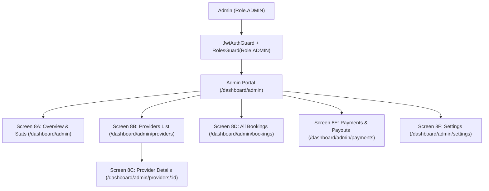

# Admin Portal (Tier 3) Specification
**Route Prefix:** `/dashboard/admin`  
**System Role:** `Role.ADMIN` (Admin Only)  
**Parent System:** Ferry Booking Marketplace  
**Parent UI Spec:** [docs/specs/ferry-booking-ui-spec.md](file:///c:/Users/Khaled/Khaled%20Dask/Backend/nestJs/docs/specs/ferry-booking-ui-spec.md)  
**Architecture Spec:** [docs/architecture/ferry-booking/01-domain-discovery.md](file:///c:/Users/Khaled/Khaled%20Dask/Backend/nestJs/docs/architecture/ferry-booking/01-domain-discovery.md)  
**Status:** Approved & Simplified  
**Date:** 2026-10-13  

---

## 1. What is this Portal?
The Admin Portal (`/dashboard/admin`) is the main control center for platform admins. It lets admins manage ferry companies (providers), monitor ticket sales, track payments and fees, and update system settings.

### What Admins Can Do:
1. **Manage Ferry Providers:** View all ferry companies, their boats, and their active status.
2. **Suspend or Enable Providers:** Temporarily stop a provider from selling tickets if there is a safety or legal issue.
3. **Track Money & Platform Fees:** View total ticket sales, platform commission (default: 10%), and payouts to providers (90%).
4. **Update Settings:** Change commission rates, payout schedules, and support contact details.

---

## 2. Top Bar & Sidebar Navigation

### Top Header Controls:
- **Title:** "Dashboard" with live active status indicator dot.
- **Date Filter:** Dropdown to select time period (`Last 15 Days`, `Last 30 Days` [default active], `Last Month`).
- **Theme Picker:** Choose look (`Default (Zinc)`).
- **Admin Profile:** Shows name (`Admin User`), email (`admin@ferrygo.com` / `admin@example.com`), and `Log Out` button.
- **Public Site Link:** Quick link opening public customer website (`/`).

### Sidebar Menu Links:
- `Overview` (`/dashboard/admin`) [Active default]
- `Providers` (`/dashboard/admin/providers`)
- `Bookings` (`/dashboard/admin/bookings`)
- `Payments & Commissions` (`/dashboard/admin/payments`)
- `Settings` (`/dashboard/admin/settings`)

---

## 3. Screen-by-Screen Details

### 🔹 Screen 8A: Admin Overview & Stats (`/dashboard/admin`)

#### 1. Top Summary Cards (4 KPI Cards with Mini Sparklines)
**Purpose:**
Display four KPI summary cards on the Platform Admin Dashboard to provide an overview of the platform's operational performance.

**UI Requirements — KPI Summary Cards:**
Display the following four KPI cards:
1. **Ferry Providers** (e.g. `4`, `0.0%` change vs last month)
2. **Total Ferries** (e.g. `7`, `+16.7%` change vs last month)
3. **Total Bookings** (e.g. `1,248`, `+12.4%` change vs last month)
4. **Total Passengers** (e.g. `2,460`, `+18.2%` change vs last month)

Each KPI card must display:
- **Title:** Name of the KPI.
- **Primary Value:** Current metric value.
- **Percentage Change:** Change compared with the previous month.
- **Trend Indicator:** Upward, downward, or neutral visual indicator (with mini 30-day SVG Sparkline area curve).

#### 2. Quick Numbers Breakdown (2 Cards)
- **Booking Stats Card:**
  - Confirmed: `6` (+14.5%).
  - Cancelled: `2` (-5.0%).
- **Money Stats Card:**
  - Total Ticket Sales: `$1,130.00` (+15.3%).
  - Provider Net Payout: `$1,017.00` (90% sent to providers, 10% kept by platform).

#### 3. Charts (Interactive SVG Visualizations)
- **Revenue Chart:** Line chart showing daily sales from Aug 01 to Aug 30 with interactive points.
- **Bookings Chart:** Grouped bar chart showing weekly booking counts (Week 1 to Week 4).

#### 4. Quick Tables
- **Recent Bookings Table:**
  - Header: "Recent Bookings" title with `View all` link (`/dashboard/admin/bookings`).
  - Columns:
    - `REFERENCE`: Booking code (e.g. `FG-20240815-001`).
    - `PASSENGER`: Lead passenger name (e.g. `Elena Rodriguez`).
    - `ROUTE`: Ports (e.g. `Honolulu → Maui`).
    - `AMOUNT`: Ticket total (e.g. `$180.00`).
    - `STATUS`: Tag (`Confirmed` [green], `Cancelled` [rose]).
    - `ACTION`: `View` link (`/manage-booking/:reference`).
- **Recent Providers Table:**
  - Header: "Recent Providers" title with `View all` link (`/dashboard/admin/providers`).
  - Columns:
    - `PROVIDER`: Company name (e.g. `Island Ferry Co.`).
    - `CONTACT PERSON`: Manager name (e.g. `James Nakamura`).
    - `FERRIES`: Active boat count (e.g. `3`).
    - `STATUS`: Status tag (`Active` [green], `Suspended` [amber]).
    - `ACTION`: `View Provider` link (`/dashboard/admin/providers/:id`).
- **Recent Payments Table:**
  - Header: "Recent Payments" title with `View all` link (`/dashboard/admin/payments`).
  - Columns:
    - `BOOKING REFERENCE`: Code (e.g. `FG-20240815-001`).
    - `PROVIDER`: Ferry company (e.g. `Island Ferry Co.`).
    - `BOOKING AMOUNT`: Gross price (e.g. `$180.00`).
    - `COMMISSION`: Platform cut (e.g. `$18.00` [10%]).
    - `PROVIDER AMOUNT`: Net payout (e.g. `$162.00` [90%]).
    - `PAYMENT STATUS`: Tag (`Completed` [green], `Pending` [amber]).
    - `ACTION`: `View` button opening details modal.

---

### 🔹 Screen 8B: Providers List (`/dashboard/admin/providers`)

- **Header & Subtitle:**
  - Title: "Providers"
  - Subtitle: "Manage registered ferry operators and provider fleets (5 active providers)."
- **Filter Tabs:** Filter chips `All (5)` [default active], `Active (4)`, `Suspended (1)`.
- **Search Bar:** Input field with placeholder `"Search by provider name, contact person..."`.
- **Providers Table:**
  - `PROVIDER`: Company brand and legal name (e.g. `Island Ferry Co.`, `BlueSea Transit`, `Coastal Lines Inc.`).
  - `CONTACT PERSON`: Primary contact (e.g. `James Nakamura`, `Maria Santos`, `Patricia Webb`).
  - `TOTAL FERRIES`: Assigned fleet count (e.g. `3`, `2`, `1`).
  - `STATUS`: Status tag (`Active` [green], `Suspended` [amber]).
  - `ACTION`: `View Provider` link opens details page (`/dashboard/admin/providers/:id`).

---

### 🔹 Screen 8C: Provider Details (`/dashboard/admin/providers/:id`)

- **Back Button:** `Back to All Providers` link navigating back to `/dashboard/admin/providers`.
- **Company Header Profile Card:**
  - Company name (e.g. `Island Ferry Co.`).
  - Verification Badge: `Verified Operator` [blue].
  - Contact info: Email (e.g. `operations@islandferry.com`), Phone, Harbor Base.
  - **Main Action Button:**
    - **Suspend Provider / Activate Provider:** High-impact toggle button to suspend operator trading permissions, instantly disabling all associated public trip bookings.
- **Section 1: Registered Vessels Fleet Table:**
  - Columns: `VESSEL NAME`, `VESSEL TYPE`, `CAPACITY (PAX)` (e.g. `120 PAX`), `YEAR BUILT` (e.g. `2021`), `STATUS` (`In Service` [green], `Dry Dock` [amber]), `ACTION` (`View Ferry` details button).
- **Section 2: Active Operating Routes Table:**
  - Columns: `ROUTE` (e.g. `Honolulu Harbor Pier 4 → Maui Lahaina`), `DEPARTURE → ARRIVAL` (e.g. `08:30 AM → 10:15 AM`), `DURATION` (e.g. `1h 45m`), `DAILY TRIPS` (e.g. `3 Trips/Day`), `BASE FARE` (e.g. `$45.00`).
- **Section 3: Recent Bookings Table:**
  - Columns: `REFERENCE` (e.g. `FG-20240815-001`), `PASSENGER` (e.g. `Elena Rodriguez`), `TRAVEL DATE` (e.g. `Aug 15, 2026`), `PAX` (e.g. `4`), `AMOUNT` (e.g. `$180.00`), `STATUS` (`Confirmed` [green], `Cancelled` [rose]).

---

### 🔹 Screen 8D: All Bookings List (`/dashboard/admin/bookings`)

- **Header & Subtitle:**
  - Title: "Bookings"
  - Subtitle: "Platform-wide reservations and ticketing manifest (1,248 total bookings recorded)."
- **Filter Tabs:** `All Bookings (5)` [default active], `Confirmed (4)`, `Cancelled (1)`.
- **Search Bar:** Placeholder `"Search booking reference, passenger name, route..."`.
- **Bookings Table:**
  - `BOOKING REFERENCE`: Alphanumeric booking code (e.g. `FG-20240815-001`).
  - `PASSENGER`: Lead passenger name (e.g. `Elena Rodriguez`).
  - `PROVIDER`: Ferry company (e.g. `Island Ferry Co.`, `BlueSea Transit`, `Pacific Crossing Ltd.`).
  - `ROUTE`: Port corridor (e.g. `Honolulu → Maui`, `Miami → Key West`).
  - `TRAVEL DATE`: Scheduled travel date (e.g. `Aug 15, 2026`).
  - `PAX`: Passenger count on ticket (e.g. `4`, `2`, `1`).
  - `AMOUNT`: Total gross ticket price (e.g. `$180.00`, `$120.00`, `$170.00`).
  - `STATUS`: Reservation status (`Confirmed` [green], `Cancelled` [rose]).
  - `ACTION`: `View Details` button opening detail modal or `/manage-booking/:reference`.

---

### 🔹 Screen 8E: Payments & Payouts (`/dashboard/admin/payments`)

- **Header & Subtitle:**
  - Title: "Payments & Commissions"
  - Subtitle: "Platform revenue splits, provider payouts, and commission processing."
- **Filter Tabs & Search:**
  - Filter tabs: `All Transactions`, `Settled / Completed`, `Pending Payout`.
  - Search input: Placeholder `"Search by booking reference, provider..."`.
- **Payments Table:**
  - `BOOKING REFERENCE`: Alphanumeric transaction reference (e.g. `FG-20240815-001`).
  - `PROVIDER`: Ferry company (e.g. `Island Ferry Co.`).
  - `BOOKING AMOUNT`: Gross ticket price paid by customer (e.g. `$180.00`).
  - `COMMISSION`: Platform cut deduction (e.g. `$18.00` [10%]).
  - `PROVIDER AMOUNT`: Net operator payout (e.g. `$162.00` [90%]).
  - `PAYMENT STATUS`: Settlement status (`Completed` [green], `Pending` [amber]).
  - `ACTION`: `View` button opening modal with Stripe payment intent ID, gateway fees, and transfer timestamp.

---

### 🔹 Screen 8F: Settings (`/dashboard/admin/settings`)

- **Header & Subtitle:**
  - Title: "Settings & Configurations"
  - Subtitle: "Manage commission policies, platform organization details, and administrator account preferences."
- **Configuration Section Tabs:**
  - `Commission Setup` (Active Tab)
  - `Platform Information`
  - `Admin Account`
- **Tab 1: Commission Setup Form:**
  - **Policy Headline:** Platform Take-Rate Schedule.
  - **Commission Percentage Preset Chips:** Options `5%`, `8%`, `10%` [default active], `12%`, `15%`.
  - **Custom Rate Input:** Number input (e.g. `10.0%`).
  - **Payout Schedule Selector:** Radio choices (`Instant Transfer`, `Weekly Payout Batch`, `Monthly Settlement`).
  - **Save Commission Policy Button:** Action button saving fee rules to database.
- **Tab 2: Platform Info Form:**
  - `Platform Name`: Input text field (default `"FerryGo"` / `"IslandHop"`).
  - `Support Email`: Input email field (default `"support@ferrygo.com"`).
  - `Support Hotline`: Input phone field.
  - `Default Platform Currency`: Dropdown selector (default `USD ($)`).
  - **Update Platform Details Button:** Submits general platform details.
- **Tab 3: Admin Account Form:**
  - `Administrator Full Name`: Input field (default `"Admin User"`).
  - `Email Address`: Input field (default `"admin@ferrygo.com"` / `"admin@example.com"`).
  - `Current Password`: Password input field.
  - `New Password`: Password input field with strength meter.
  - **Update Credentials Button:** Action button submitting security credentials update.

---

## 4. Admin API Endpoints (`/api/v1/admin/*`)

All routes require: Admin Login (`Role.ADMIN`).

| Method | URL | What it does | Parameters |
|---|---|---|---|
| `GET` | `/api/v1/admin/analytics/overview` | Gets dashboard summary numbers and charts | `?period=30d` |
| `GET` | `/api/v1/admin/providers` | Gets list of all ferry providers | `?status=ACTIVE&search=name` |
| `GET` | `/api/v1/admin/providers/:id` | Gets full details of one provider | N/A |
| `PATCH` | `/api/v1/admin/providers/:id/status` | **Suspend or Enable a provider** | `{ "status": "SUSPENDED", "reason": "text" }` |
| `GET` | `/api/v1/admin/bookings` | Gets all customer bookings | `?status=CONFIRMED&page=1` |
| `GET` | `/api/v1/admin/payments` | Gets list of all payments and fees | `?status=COMPLETED&page=1` |
| `GET` | `/api/v1/admin/settings` | Gets current fees and platform settings | N/A |
| `PATCH` | `/api/v1/admin/settings/commission` | Updates platform fee rate and payout schedule | `{ "rate": 10.0, "schedule": "WEEKLY" }` |
| `PATCH` | `/api/v1/admin/settings/platform` | Updates support email and platform name | `{ "name": "FerryGo", "email": "..." }` |

---

## 5. Important Rules & Security

### 1. What Happens When a Provider is Suspended?
When Admin clicks "Suspend Provider":
- Provider status changes to `SUSPENDED`.
- All upcoming trips of this provider that have 0 bookings are **instantly hidden** from the customer search page (`/book`).
- Existing customers who already paid are **not deleted**; their tickets stay safe and valid for travel or refund.
- The provider can no longer add new boats or create new schedules.

### 2. Access Protection & Role Security
- Regular passengers (`Role.CUSTOMER`) and operators (`Role.OPERATOR`) cannot access `/api/v1/admin/*` routes or `/dashboard/admin/*` pages.
- Protected by NestJS `JwtAuthGuard` and `RolesGuard(Role.ADMIN)`.
- Every sensitive action (such as suspending an operator or altering fee rates) is written to an audit log.

---

## 6. Technical Gaps & Design Decisions for Admin

| # | Topic | Current Reality | Recommended Solution |
|---|---|---|---|
| **1** | **Dynamic Commission Rate** | Frontend currently hardcodes a 10% fee. | Store a default fee in `PlatformSettings` table, with an optional custom rate per provider in the `Provider` table. |
| **2** | **Suspension Cascading Logic** | Clicking "Suspend" on frontend needs backend support. | Use a transactional database service to atomically mark provider `SUSPENDED` and hide unbooked schedules. |
| **3** | **Payout Processing** | Payout split numbers (90% / 10%) need gateway automation. | Integrate Stripe Connect destination transfers at payment capture, and record payout batch status in database. |
| **4** | **Strict Admin Guards** | Shared `/dashboard` prefix can cause confusion. | NestJS route guards strictly enforce `Role.ADMIN` for all `/dashboard/admin` and `/api/v1/admin` paths. |
