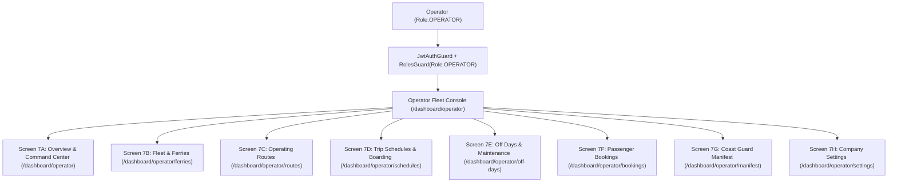

# Operator Fleet Console (Tier 2) Specification
**Route Prefix:** `/dashboard/operator`  
**System Role:** `Role.OPERATOR` (Operator Only)  
**Parent System:** Ferry Booking Marketplace  
**Parent UI Spec:** [docs/specs/ferry-booking-ui-spec.md](file:///c:/Users/Khaled/Khaled%20Dask/Backend/nestJs/docs/specs/ferry-booking-ui-spec.md)  
**Admin UI Spec:** [docs/specs/ferry-booking-admin-ui-spec.md](file:///c:/Users/Khaled/Khaled%20Dask/Backend/nestJs/docs/specs/ferry-booking-admin-ui-spec.md)  
**Status:** Approved & Simplified  
**Date:** 2026-10-13  

---

## 1. What is this Console?
The Operator Fleet Console (`/dashboard/operator`) is the daily work hub for commercial ferry companies. It allows ferry operators to manage their boats, set up routes, schedule daily trips, view customer reservations, and check in passengers using the Coast Guard manifest.

### What Operators Can Do:
1. **Manage Fleet of Boats:** Register new vessels, update seat counts, and track maintenance status.
2. **Setup Island Routes:** Configure departure and destination ports, travel duration, and border crossing needs.
3. **Daily Trip Schedules:** Assign boats and captains to departure times and gates, and update live trip status (`Boarding`, `Departed`, `Delayed`, `Cancelled`).
4. **Calendar Off-Days:** Block dates for dry-dock maintenance, stormy weather, or public holidays.
5. **Passenger Bookings & Check-In:** Look up passenger reservations and mark tickets as checked in.
6. **Coast Guard Passenger Manifest:** Roll-call passengers before departure, verify ID/passport numbers, scan digital boarding passes, and confirm luggage counts.
7. **Company Profile & Defaults:** Manage pier address, default buffer turnaround times, and company contacts.

---

## 2. Top Bar & Sidebar Navigation

### Top Header Bar:
- **Operator Identity:** Displays company trading name (e.g. `Island Ferry Co.` / `Oceanic Ferries Ltd.`) and assigned pier (e.g. `Honolulu Harbor Pier 4` / `Malé Villingili Terminal`).
- **Fleet Status Badge:** Live indicator tag showing operational health (e.g. `Normal Operations` [green] / `Live`).
- **Operator Profile & Session:** Displays operator name, contact email, and `Log Out` button.
- **View Public Site:** Direct link returning to customer booking storefront (`/`).

### Sidebar Menu Links:
- `Overview` (`/dashboard/operator`) [Active default]
- `Ferries` (`/dashboard/operator/ferries`)
- `Routes` (`/dashboard/operator/routes`)
- `Schedules` (`/dashboard/operator/schedules`)
- `Off Days` (`/dashboard/operator/off-days`)
- `Bookings` (`/dashboard/operator/bookings`)
- `Manifest` (`/dashboard/operator/manifest`)
- `Settings` (`/dashboard/operator/settings`)

---

## 3. Screen-by-Screen Details

### 🔹 Screen 7A: Overview & Operations Command Center (`/dashboard/operator`)

#### 1. Fleet KPI Summary Cards (4 Metrics)
- **Today's Passengers:** Total passenger count for the day (e.g. `348`) with volume trend.
- **Active Fleet:** Ratio of operational boats (e.g. `3/3 Vessels in service`).
- **Today's Bookings:** Daily reservation count (e.g. `94`) with boat load factor.
- **Net Revenue:** Real-time earnings in USD (e.g. `$10,480.00`).

#### 2. Today's Departures Schedule Queue
Displays current day departures in real time.
- **Columns:**
  - `Departure Time`: Scheduled departure time (e.g. `08:30 AM`).
  - `Route`: Origin and destination (e.g. `Honolulu ➔ Maui`).
  - `Assigned Vessel`: Name of the boat (e.g. `Ocean Voyager I`).
  - `Booked / Capacity`: Current seat occupancy ratio (e.g. `172 / 180`).
  - `Departure Status`: Dropdown selector (`On Time`, `Boarding`, `Departed`, `Delayed`, `Cancelled`).
  - `Actions`: `View Manifest` link directing to departure roll call (`/dashboard/operator/manifest?tripId=:tripId`).

#### 3. Upcoming Scheduled Trips Grid
- Visual cards displaying vessel name, route tags, departure time, and capacity progress bar (`X / Y` booked, `Z` seats remaining).
- **Manage Schedule CTA:** Direct link to edit slot in schedule manager (`/dashboard/operator/schedules/:scheduleId`).

---

### 🔹 Screen 7B: Fleet & Ferries Management (`/dashboard/operator/ferries`)

#### 1. Header & Quick Numbers
- **Title:** "Fleet & Ferries"
- **Subtitle:** "Manage registered passenger vessels, catamarans, and seaworthiness status."
- **Primary CTA:** `Add New Ferry` button (opens vessel registration modal dialog).
- **Summary Cards (3 Cards):**
  - **Total Ferries:** `3 Vessels` (In service).
  - **Total Fleet Capacity:** `550 Seats` (Combined passenger seats across all boats).
  - **Average Speed:** `28.0 Knots` (High-speed catamaran fleet).

#### 2. Registered Ferry Fleet Data Table
- **Columns:**
  - `FERRY NAME`: Boat name and type (e.g. `Ocean Voyager I` • High-Speed Catamaran).
  - `FERRY ID / REGISTRATION`: Official registration code (e.g. `HI-9921-C`, `HI-8843-H`).
  - `TOTAL SEATS`: Numeric passenger seat capacity (e.g. `180 Seats`, `120 Seats`, `250 Seats`).
  - `ASSIGNED ROUTE`: Assigned port pairing tag (e.g. `Honolulu ⇄ Maui`, `Honolulu ⇄ Lanai`).
  - `STATUS`: Sea-ready status badge (`In Service` [green], `Maintenance` [amber]).
  - `ACTION`: `Edit Ferry` button (opens vessel configuration modal to update details or toggle maintenance).

---

### 🔹 Screen 7C: Operating Routes Editor (`/dashboard/operator/routes`)

#### 1. Header & Filters
- **Title:** "Operating Routes"
- **Subtitle:** "Manage inter-island passenger lines, assigned ferries, duration, and border crossing controls."
- **Primary CTA:** `Add Route` button (opens route creation modal).
- **Filter Tabs:**
  - `All Routes (4)`: Shows all active routes (default).
  - `Yes (Border) (1)`: Routes requiring customs / international border clearance.
  - `No (Domestic) (3)`: Regular domestic inter-island routes.

#### 2. Configured Ferry Routes Data Table
- **Columns:**
  - `DEPARTURE PORT`: Port of origin (e.g. `Honolulu Pier 4`, `Charlotte Amalie Port`).
  - `DESTINATION PORT`: Arrival port (e.g. `Kahului Harbor, Maui`, `Road Town Pier, BVI`).
  - `ASSIGNED FERRY`: Vessel allocated to route (e.g. `Ocean Voyager I`, `Pacific Wave Runner`).
  - `DURATION`: Travel time (e.g. `1h 45m`, `1h 15m`, `55m`).
  - `BORDER CROSSING`: Requirement badge (`No (Domestic)` or `Yes` with border check icon).
  - `STATUS`: Route state badge (`Active` [green]).
  - `ACTION`: `Edit Route` button (opens route editor modal).

---

### 🔹 Screen 7D: Trip Schedules & Boarding (`/dashboard/operator/schedules`)

#### 1. Header & Filters
- **Title:** "Trip Schedules & Boarding"
- **Subtitle:** "Manage daily ferry departures, gate allocations, and real-time vessel readiness."
- **Primary CTA:** `Add Schedule` button (opens departure timetable scheduler modal).
- **Operational Filter Tabs:**
  - `All Trips (5)`: Complete daily timetable.
  - `Boarding Now`: Active departures currently loading passengers.
  - `Upcoming`: Scheduled future departures for the day.
  - `Departed`: Completed voyages.

#### 2. Today's Operational Schedule Data Table
- **Columns:**
  - `DEPARTURE`: Scheduled departure time (e.g. `08:30 AM`).
  - `ARRIVAL`: Estimated arrival time (e.g. `10:15 AM`).
  - `FERRY / VESSEL`: Assigned boat name (e.g. `Ocean Voyager I`).
  - `ROUTE`: Port origin ➔ destination (e.g. `Honolulu → Maui`).
  - `GATE / DOCK`: Terminal pier and gate (e.g. `Pier 4 - Gate A`, `Pier 4 - Gate B`).
  - `CAPTAIN`: Duty Master name (e.g. `Capt. Mark Kealoha`).
  - `CAPACITY / LOAD`: Live occupancy progress bar and ratio (e.g. `172 / 180`, `96%`).
  - `STATUS`: Status tag (`Departed` [neutral], `Boarding` [blue], `On Schedule` [green], `Preparing` [amber]).
  - `ACTION`:
    - `Edit Schedule`: Button to modify departure gate or timings.
    - `Manifest`: Link button directing straight to passenger roll call (`/dashboard/operator/manifest?tripId=:tripId`).

---

### 🔹 Screen 7E: Off Days & Fleet Maintenance (`/dashboard/operator/off-days`)

#### 1. Header & Primary Action
- **Title:** "Off Days & Maintenance"
- **Subtitle:** "Block booking slots for vessel dry-docking, public holidays, or scheduled port maintenance."
- **Primary CTA:** `Schedule Off Day` button (opens calendar blackout modal).

#### 2. Scheduled Fleet Off-Days Data Table
- **Columns:**
  - `DATE`: Blocked calendar date (e.g. `2026-09-15`, `2026-09-24`, `2026-10-14`).
  - `EVENT / REASON`: Description (e.g. `Annual Hull & Engine Overhaul`, `Tropical Swell Weather Precaution`, `King Kamehameha Harbor Holiday`).
  - `CATEGORY`: Category tag (`Scheduled Maintenance`, `Weather Warning`, `Public Holiday`).
  - `AFFECTED VESSEL`: Specific vessel or `All Vessels`.
  - `AFFECTED ROUTE`: Targeted route or `All Inter-Island Routes`.
  - `STATUS`: Confirmation badge (`Confirmed` [green], `Tentative` [amber]).
  - `ACTION`: `Edit Off-Day` button (opens event editor or delete option).

---

### 🔹 Screen 7F: Passenger Bookings & Reservations (`/dashboard/operator/bookings`)

#### 1. Header & Search
- **Title:** "Passenger Bookings"
- **Subtitle:** "View customer reservations, verify tickets, and manage boarding check-in."
- **Status Tabs:** `All Bookings (5)`, `Confirmed`, `Checked In`.
- **Search Input:** Text field with placeholder `"Search passenger, reference..."` (filters by name, email, or booking reference).

#### 2. Reservations & Tickets Data Table
- **Columns:**
  - `REFERENCE`: Alphanumeric reservation ID (e.g. `FG-20240815-001`).
  - `PASSENGER`: Lead passenger full name (e.g. `Elena Rodriguez`).
  - `EMAIL`: Contact email address (e.g. `elena.rodriguez@example.com`).
  - `ROUTE`: Port pair (e.g. `Honolulu → Maui`).
  - `VESSEL`: Assigned boat (e.g. `Ocean Voyager I`).
  - `DEPARTURE`: Scheduled departure time (e.g. `08:30 AM`).
  - `PAX`: Total passengers on ticket (e.g. `4`).
  - `AMOUNT`: Total ticket fare paid (e.g. `$180.00`).
  - `STATUS`: Check-in state badge (`Confirmed` [green], `Checked In` [blue]).
  - `ACTION`:
    - `Check In`: Inline button on `Confirmed` rows to immediately mark passenger as checked in.
    - `View`: Link navigating to full reservation details (`/manage-booking/:reference`).

---

### 🔹 Screen 7G: Passenger Manifest & Boarding Audit (`/dashboard/operator/manifest`)

#### 1. Header & Live Scanner Action
- **Title:** "Passenger Manifest & Boarding"
- **Subtitle:** "Official Coast Guard compliance passenger manifest, deck luggage, and boarding audit."
- **Primary CTA:** `Scan Boarding Pass` button (opens device camera / barcode QR scanner to quickly scan passenger digital passes).

#### 2. Active Trip Selector Cards
- Daily trip cards listing trip manifest ID (e.g. `MAN-20260908-01`), route, boat name, departure time, and loaded passenger counter (`Boarded: 98 PAX / Cap: 120`).
- Selecting a card instantly updates the active passenger roll-call table below.

#### 3. Selected Trip Header Card
- Displays boat name, route, Duty Master (Captain), travel date, and visual boarding counter (`98 / 114 Boarded`).
- **Search Manifest Input:** Text input field (`"Search manifest by name, ticket, passport..."`).

#### 4. Coast Guard Passenger Roll Call Data Table
- **Columns:**
  - `TICKET #`: Ticket identifier (e.g. `TCK-88210-A`).
  - `PASSENGER NAME`: Verified full name (e.g. `Michael Chang`).
  - `NATIONALITY`: Passenger nationality for maritime compliance (e.g. `USA`, `Canada`, `Japan`).
  - `PASSPORT / ID`: Official ID number (e.g. `P-8829104`).
  - `CABIN CLASS`: Ticket class tier (e.g. `VIP Upper Deck`, `Business`, `Standard`).
  - `LUGGAGE`: Checked bags count (e.g. `2 bags`, `1 bags`).
  - `STATUS`: Boarding status (`Boarded` [green], `Checked In` [blue], `Pending` [amber]).
  - `ACTION`:
    - `Confirm Boarded`: Button to officially clear passenger onto vessel ramp.
    - `Undo Boarding`: Button to revert boarded status if a passenger steps off before departure.

---

### 🔹 Screen 7H: Operator Profile & Operational Settings (`/dashboard/operator/settings`)

#### 1. Company Information Form
- `Provider Name`: Input text field (e.g. `Oceanic Ferries Ltd.`).
- `Contact Email`: Input email field (e.g. `operations@oceanicferries.com`).
- `Business Address`: Input address field (e.g. `120 Harbor View Dr, Seattle, WA 98104`).
- **Save Changes Button:** Saves company profile changes.

#### 2. Schedule Defaults Form
- **Enable Auto-Scheduling:** Toggle switch controlling automatic timetable generation based on past demand.
- **Manage All Link:** Link navigating back to schedule timetable (`/dashboard/operator/schedules`).

#### 3. Active Route Zones
- Route zone cards (e.g. `North Sound Line` [Active], `Coastal Express` [Seasonal]).
- **Configure New Route Action:** Card button opening route line generator.

#### 4. Operational Off Days
- **Add Date Button:** Quick action button to add a holiday or dock closure.
- **Scheduled Events List:** Cards with Month/Day badge (e.g. `DEC 25` Christmas Day, `JAN 15` Scheduled Maintenance), affected boat scope, and `Delete` trash button.

---

## 4. Operator API Endpoints (`/api/v1/operator/*`)

All routes require: Operator Login (`Role.OPERATOR` or `Role.ADMIN`).  
Tenant Isolation: Every query is automatically scoped to the logged-in operator's `providerId`.

| Method | URL | What it does | Parameters / Body |
|---|---|---|---|
| `GET` | `/api/v1/operator/overview` | Gets operator dashboard summary numbers and today's queue | N/A |
| `GET` | `/api/v1/operator/ferries` | Gets list of all boats owned by this operator | `?status=IN_SERVICE` |
| `POST` | `/api/v1/operator/ferries` | Registers a new boat | `{ "name": "...", "registration": "...", "capacity": 180, "type": "CATAMARAN" }` |
| `PATCH` | `/api/v1/operator/ferries/:id` | Updates boat details or maintenance status | `{ "status": "MAINTENANCE", "capacity": 180 }` |
| `GET` | `/api/v1/operator/routes` | Gets routes configured by this operator | `?borderCrossing=true|false` |
| `POST` | `/api/v1/operator/routes` | Adds a new route pairing | `{ "departurePortId": "...", "destinationPortId": "...", "durationMinutes": 105, "borderCrossing": false }` |
| `PATCH` | `/api/v1/operator/routes/:id` | Updates route duration or assigned boat | `{ "durationMinutes": 90, "ferryId": "..." }` |
| `GET` | `/api/v1/operator/schedules` | Gets departure timetables | `?date=2026-08-25&status=BOARDING` |
| `POST` | `/api/v1/operator/schedules` | Creates a new daily departure schedule slot | `{ "ferryId": "...", "routeId": "...", "departureTime": "...", "arrivalTime": "...", "gate": "Pier 4 - Gate A", "captain": "Capt. Mark" }` |
| `PATCH` | `/api/v1/operator/schedules/:id/status` | **Updates live departure status** | `{ "status": "BOARDING" | "DEPARTED" | "DELAYED" | "CANCELLED" }` |
| `GET` | `/api/v1/operator/off-days` | Gets scheduled maintenance and holiday off-days | `?year=2026` |
| `POST` | `/api/v1/operator/off-days` | Blocks off a date for boat maintenance or holiday | `{ "date": "2026-09-15", "reason": "...", "category": "MAINTENANCE", "ferryId": "..." }` |
| `DELETE` | `/api/v1/operator/off-days/:id` | Removes an off-day blackout | N/A |
| `GET` | `/api/v1/operator/bookings` | Gets customer reservations for this operator's boats | `?status=CONFIRMED&search=...&page=1` |
| `PATCH` | `/api/v1/operator/bookings/:id/check-in` | Marks passenger reservation as checked in | `{ "checkedIn": true }` |
| `GET` | `/api/v1/operator/manifest` | Gets official Coast Guard roll call for a trip | `?tripId=:tripId` |
| `PATCH` | `/api/v1/operator/manifest/:ticketId/board` | Confirms passenger boarded onto vessel ramp | `{ "boarded": true, "luggageCount": 2 }` |
| `PATCH` | `/api/v1/operator/manifest/:ticketId/unboard` | Reverts boarding status if passenger steps down | `{ "boarded": false }` |
| `GET` | `/api/v1/operator/settings` | Gets company profile and operator settings | N/A |
| `PATCH` | `/api/v1/operator/settings` | Updates company address and operator settings | `{ "name": "...", "email": "..." }` |

---

## 5. Important Rules & Security

### 1. Multi-Tenant Fleet Isolation
- An operator can **only see and modify their own company's boats, routes, schedules, bookings, and manifests**.
- In NestJS services, every database query must strictly filter by `where: { providerId: req.user.providerId }`.
- Cross-operator data leaks are strictly prevented.

### 2. Coast Guard Passenger Manifest Rules
- Every passenger boarding an inter-island boat must have: Full Legal Name, Nationality, and Passport/National ID number recorded.
- Once a trip's status is changed to `DEPARTED`, the passenger manifest becomes an immutable historical record for maritime safety compliance.
- Luggage counts must be verified on ramp entry to prevent exceeding vessel weight limits.

### 3. Vessel Schedule Conflict Validation
- When scheduling trips for the same vessel, the system enforces that a vessel cannot be scheduled for multiple overlapping voyages simultaneously.

### 4. Role-Based Access Control (RBAC)
- Only users with `Role.OPERATOR` or `Role.ADMIN` can access `/dashboard/operator/*` and `/api/v1/operator/*`.
- Regular customers (`Role.CUSTOMER`) are blocked with HTTP `403 Forbidden` via `RolesGuard`.

---

## 6. Technical Gaps & Design Decisions for Operator

| # | Topic | Current Reality | Recommended Solution |
|---|---|---|---|
| **1** | **Shared Login Entrypoint** | Homepage links both customer and operator to `/login`. | Keep `/login` with clean role switcher tabs (`Passenger` vs `Ferry Operator`), redirecting operators automatically to `/dashboard/operator` after successful authentication. |
| **2** | **Seat Capacity Clamping** | Customer booking wizard needs real-time capacity checks. | Operator schedule manager sets the exact seat cap from the assigned boat; booking wizard clamps passenger counter to remaining capacity. |
| **3** | **Digital Boarding Pass Scanner** | Manifest screen has a "Scan Boarding Pass" button. | Integrate HTML5 QR/Barcode camera reader library that parses ticket JWT/ref and triggers `PATCH /manifest/:ticketId/board`. |
| **4** | **Departure Status Real-Time Push** | Departure queue status changes need to reflect on customer screens. | When operator changes departure status to `BOARDING` or `DELAYED`, emit a WebSocket or SSE event to update passenger ticket views. |
