# Ferry Search & Booking - UI/UX Flow Specification

## 1. Overview & Context
This document serves as the **Single Source of Truth (SSOT)** for the frontend implementation of the Ferry Search & Booking platform, reverse-engineered from the live deployment following the `agency-ui-discovery` forensic audit protocol.

* **Live Reference:** `https://island-hop-web-pi.vercel.app`
* **Core Domains:** Ports, Routes, Ferry Schedules, Tickets, Multi-step Checkout Wizard, Self-Service Booking Portal, Operator Fleet Console.
* **Interactive Excalidraw Diagram:** [docs/specs/ferry-booking-user-journey.excalidraw](file:///c:/Users/Khaled/Khaled%20Dask/Backend/nestJs/docs/specs/ferry-booking-user-journey.excalidraw) *(Workspace root: [ferry-booking-user-journey.excalidraw](file:///c:/Users/Khaled/Khaled%20Dask/Backend/nestJs/ferry-booking-user-journey.excalidraw))*
* **Dedicated Tier Specifications:**
  - **Tier 2 (Operator Fleet Console):** [docs/specs/ferry-booking-operator-ui-spec.md](file:///c:/Users/Khaled/Khaled%20Dask/Backend/nestJs/docs/specs/ferry-booking-operator-ui-spec.md)
  - **Tier 3 (Platform Admin Portal):** [docs/specs/ferry-booking-admin-ui-spec.md](file:///c:/Users/Khaled/Khaled%20Dask/Backend/nestJs/docs/specs/ferry-booking-admin-ui-spec.md)

---

## 2. Complete High-Level User Journey

> [!TIP]
> **Interactive Visual Diagram Available:** Open the dedicated visual diagram for this customer journey in Excalidraw:
> 👉 **[docs/specs/ferry-booking-user-journey.excalidraw](file:///c:/Users/Khaled/Khaled%20Dask/Backend/nestJs/docs/specs/ferry-booking-user-journey.excalidraw)**

```mermaid
flowchart TD
    %% Entry Points & Landing Page Sections
    subgraph LandingPage ["Screen 1: Landing Page (/)"]
        Nav["Global Header Nav<br/>(Book, Routes, Help, Dashboard, Logout)"]
        A["Section 1A: Hero Search Widget (/#book)<br/>Toggle, Ports, Date, Passengers, Chips"]
        A_Pop["Section 1B: Popular Journeys (/#schedules)<br/>Category Tabs & 4 Route Cards"]
        A_How["Section 1C: Mobile App Downloads (/#how-it-works)<br/>(App Store & Google Play Links)"]
        A_Manage["Section 1D: Self-Service Portal (/#manage-booking)<br/>(Booking Ref, Demo ID, Email/Phone)"]
        A_Op["Section 1E: Operator Fleet Entrypoints<br/>(Console Login, Partner Dashboard)"]
        A_Faq["Section 1F: FAQs & Support (/#faqs)<br/>(5 Radix Accordions + Concierge Links)"]
        A_CTA["Section 1G: Direct Route CTAs<br/>(Browse Routes, Search Timetables)"]
        A_Foot["Section 1H: Global Footer<br/>(Platform, Company, Support, App Links)"]
    end

    %% Interactions from Landing Page
    Nav -->|"Click 'Book' or Logo"| LandingPage
    Nav -->|"Click 'Routes'"| RoutesPage["Screen 2: Routes Catalog (/routes)"]
    Nav -->|"Click 'Help'"| HelpPage["Help Center (/help)"]
    Nav -->|"Click 'Dashboard'"| DashPage["Partner Dashboard (/dashboard)"]
    Nav -->|"Click 'Log Out'"| LogoutAction["Client Auth Reset"]

    A -->|"Click 'Popular Quick Route' Chip"| A1["In-Page Form Autofill<br/>(No page reload)"]
    A -->|"Click 'Search Ferries'"| B["Screen 3: Available Ferries (/book)<br/>Query Params: from, to, date, passengers"]
    
    A_Pop -->|"Click Category Tab"| A_Filter["Instant In-Page Client Filter<br/>(All Routes / Speedboat / Scenic)"]
    A_Pop -->|"Click 'View all routes'"| RoutesPage
    A_Pop -->|"Click 'View Trips' on Card"| RoutesPageCard["Screen 2: Routes Catalog (/routes?from=...&to=...)"]

    A_How -->|"Click 'App Store' / 'Google Play'"| ExternalStores["External App Stores (New Tab)"]

    A_Manage -->|"Click 'Try demo ID'"| ManageDemo["Autofill 'FRY-8842' in Input"]
    A_Manage -->|"Click 'Find My Trip'"| ManagePage["Screen 5: Manage Booking Portal (/manage-booking)"]
    A_Manage -->|"Click 'Sign in to view all trip passes'"| LoginPage["Screen 6: Auth / Login Portal (/login)"]

    A_Op -->|"Click 'Operator Console Login'"| LoginPage
    A_Op -->|"Click 'Explore Partner Dashboard'"| DashPage["Screen 7: Operator Fleet Console (/dashboard)"]

    %% Manage Booking Interactivity
    ManagePage -->|"Click 'Download Ticket'"| TicketView["Digital Pass (/tickets/:ref)"]
    ManagePage -->|"Click 'Cancel Booking'"| CancelModal["Cancel Booking Modal Dialog"]
    ManagePage -->|"Click 'View Details'"| DetailView["Booking Details (/manage-booking/:ref)"]

    %% Auth & Login Flow
    LoginPage -->|"Role: Passenger + Sign In"| LandingPage
    LoginPage -->|"Role: Operator + Sign In"| DashPage
    LoginPage -->|"Role: Admin + Sign In (admin@example.com)"| AdminPage["Screen 8: Super Admin Portal (/dashboard/admin)"]
    LoginPage -->|"Click 'Forgot password?'"| ForgotPage["Password Reset (/forgot-password)"]
    LoginPage -->|"Click 'Create Account'"| SignupPage["Sign Up (/signup?role=...)"]

    %% Operator Console Navigation
    DashPage -->|"Click Sidebar Items"| OperatorSubroutes["Operator Sub-routes<br/>(/dashboard/operator/ferries, routes, schedules)"]
    DashPage -->|"Click 'Manifest'"| ManifestView["Coast Guard Manifest (/dashboard/operator/manifest)"]

    %% Super Admin Platform Console Navigation
    AdminPage -->|"Click 'Providers'"| AdminProviders["Screen 8B: Providers Console (/dashboard/admin/providers)"]
    AdminProviders -->|"Click 'View Provider'"| AdminProviderAudit["Screen 8C: Provider Deep-Dive (/dashboard/admin/providers/:id)"]
    AdminPage -->|"Click 'Bookings'"| AdminBookings["Screen 8D: Master Bookings (/dashboard/admin/bookings)"]
    AdminPage -->|"Click 'Payments'"| AdminPayments["Screen 8E: Payments & Commissions (/dashboard/admin/payments)"]
    AdminPage -->|"Click 'Settings'"| AdminSettings["Screen 8F: Platform Settings (/dashboard/admin/settings)"]

    A_Faq -->|"Click Accordion Header"| FaqToggle["Toggle Expand/Collapse Answer"]
    A_Faq -->|"Click 'Chat with Concierge' or 'Help Center'"| HelpPage

    A_CTA -->|"Click 'Find a Ferry Route'"| RoutesPage
    A_CTA -->|"Click 'Search Timetables'"| A

    A_Foot -->|"Click Social Icons"| SocialLinks["External Social Networks (New Tab)"]
    A_Foot -->|"Click Anchor Links (#book, #schedules, etc.)"| LandingPage
    A_Foot -->|"Click Page Links (/routes, /help)"| RoutesPage

    %% Routes Catalog to Booking
    RoutesPage -->|"Click 'View Trips' on Catalog Card"| B
    RoutesPageCard -->|"Click 'View Trips' on Catalog Card"| B

    %% Booking & Checkout Flow
    B -->|"Click 'Select Trip' on Ferry Card"| C["Screen 4 - Step 1: Select Trip / Review<br/>(/book/:tripId/review)"]
    C -->|"Click '[Change Trip]'"| B
    C -->|"Click '+ / -' Passenger Counter"| C1["Instant Recalculation<br/>Sticky Booking Card Updates"]
    C -->|"Click 'Continue to Passenger Details'"| D["Screen 4 - Step 2: Passenger Details<br/>(/book/:tripId/passengers)"]
    D -->|"Click 'Back to Select Trip'"| C
    D -->|"Click 'Continue to Payment'"| E["Screen 4 - Step 3: Payment<br/>(/book/:tripId/payment)"]
    E -->|"Click 'Back to Passenger Details'"| D
    E -->|"Click 'Pay & Confirm'"| F["Screen 4 - Step 4: Confirmation<br/>(/book/:tripId/confirmation)"]
```

---

## 3. Screen-by-Screen UI Structure & Interactive Click Flow

### 📱 Screen 1: Landing Page (`/`)

---

## Global Header & Navigation Bar

### 1. Desktop Navbar
- **Brand Logo:** IslandHop Ferry Express, links to `/`.
- **Navigation Menu:**
  - **Book:** Links to `/`.
  - **Routes:** Links to `/routes`.
  - **Help:** Links to `/help`.
- **Right Actions:**
  - **Dashboard:** Links to `/dashboard`.
  - **Log Out:** Logs out user session.

### 2. Mobile Navbar
- **Brand Logo:** IslandHop Ferry Express, links to `/`.
- **Hamburger Menu:** Toggles mobile navigation drawer.

---

## Section 1A: Hero Search Widget (`#book`)

### Search Card & Form Inputs
- **Trip Type Toggle:**
  - **One way:** Single journey (default active).
  - **Round trip:** Round-trip travel *(Gap #1: No return date field appears)*.
- **Form Fields:**
  - **From (Departure):** Dropdown combobox, default `"Malé (Villingili Terminal)"`.
  - **Swap Ports:** A circular icon button that swaps the selected departure and destination ports when clicked.
  - **To (Destination):** Dropdown combobox, default `"Maafushi Island Port"`.
  - **Travel Date:** Date picker calendar, default `"Aug 25, 2026"`.
  - **Passengers:** Dropdown selector (`1 Passenger`, `2 Passenger`, `3 Passenger`, `4+ Group Passenger`).
- **Action Button:**
  - **Search Ferries:** Navigates to Available Ferries page (`/book`).
    - **Data Passed:** Query parameters (`tripType=one-way&from=Malé (Villingili Terminal)&to=Maafushi Island Port&departureDate=2026-08-25&passengers=1 Passenger`).
    - **Destination Screen Details (Available Ferries `/book`):**
      - **1. Persistent Search Bar:** Embedded search widget pre-filled with active query parameters (`from`, `to`, `departureDate`, `passengers`) for instant in-page query modifications.
      - **2. Available Ferry Results Grid:**
        - **Trip Schedule Cards:** Displays operator name, departure/arrival timestamps, ports, available seat count, and pricing.
        - **Select Trip CTA:** Navigates to Checkout Wizard - Step 1 (`/book/:tripId/review`).
          - **Data Passed:** Path param `:tripId` (e.g. `trip-1`) and query parameters (`passengers`, `departureDate`, `from`, `to`, `tripType`).
          - **Target Screen Behavior:** Step 1 loads the selected trip summary and initializes the ticket counter with the selected passenger count.
- **Popular Quick Route Chips (In-page autofill, no page reload):**
  - **Malé ⇄ Maafushi:** Fills From: Malé, To: Maafushi.
  - **Malé ⇄ Thulusdhoo:** Fills From: Malé, To: Thulusdhoo.
  - **Malé ⇄ Dhiffushi:** Fills From: Malé, To: Dhiffushi.
---

## ⚡ Quick Search — Backend Requirements

### 1. Required Inputs
- **Journey Type:** One-Way or Round-Trip.
- **Departure Port:** Port where the journey starts.
- **Destination Port:** Port where the customer wants to go.
- **Travel Date:** Departure date.
- **Return Date:** Required for Round-Trip journeys; not required for One-Way journeys.
- **Passengers:** Number of passengers (1, 2, 3, or 4+).

### 2. Backend Validation Rules
- Validate that the departure and destination ports are valid and different.
- Validate the travel date.
- For **Round-Trip**, require a valid return date that is on or after the departure date.
- For **One-Way**, the return date is not required.
- Validate the passenger count as a supported value.
- Return appropriate validation errors for invalid or missing inputs.

### 3. Expected Output
When the customer clicks **Search Ferries**, the backend should use the submitted query parameters to find matching available ferry trips.
- Match the departure and destination ports.
- Return available ferries for the selected departure date.
- Check seat availability against the requested passenger count.
- For Round-Trip journeys, return matching outbound and return trip options based on the selected dates.
- Return structured results with the relevant trip details and availability information.

### 4. Popular Routes
- Return the **Top 5 Popular Routes** based on the highest number of bookings.
- Include each route's departure and destination port details.
- Allow the frontend to use these results to populate the corresponding search inputs when a customer selects a popular route.
- Return the routes in popularity order.

### Customer Goal
Provide a backend search service that validates travel details, finds available ferry trips, supports One-Way and Round-Trip journeys, and returns the Top 5 Popular Routes.

---

## Section 1B: Popular Journeys (`#schedules`)

### 1. Category Filter Tabs & Header Action
- **Category Filter Tabs:**
  - **All Routes:** Displays all 4 route cards (default active).
  - **Speedboat Express:** Filters speedboat routes in-memory.
  - **Scenic Atoll Tours:** Filters scenic tour routes in-memory.
- **Header Action:**
  - **View all routes:** Navigates to Routes Catalog (`/routes`).

### 2. Route Cards Grid (4 Popular Journeys)
- **Malé ➔ Maafushi:**
  - **Metadata:** 4.9 rating, approx. 35 min, 6 daily trips.
  - **Amenities:** Air Conditioned, Fast Speedboat, Free 20kg Bag.
  - **Fares:** From $30 / person.
  - **View Trips:** Navigates to Routes Catalog (`/routes?from=Malé&to=Maafushi`) *(Gap #7: Two-step redirection loop)*.
- **Malé ➔ Thulusdhoo:**
  - **Metadata:** 4.8 rating, approx. 45 min, 4 daily trips.
  - **Amenities:** Surfboard Allowed, Scenic Deck, Fast WiFi.
  - **Fares:** From $30 / person.
  - **View Trips:** Navigates to Routes Catalog (`/routes?from=Malé&to=Thulusdhoo`) *(Gap #7)*.
- **Malé ➔ Dhiffushi:**
  - **Metadata:** 4.9 rating, approx. 40 min, 4 daily trips.
  - **Amenities:** Shaded Seating, Sunset Cruise, Snack Bar.
  - **Fares:** From $30 / person.
  - **View Trips:** Navigates to Routes Catalog (`/routes?from=Malé&to=Dhiffushi`) *(Gap #7)*.
- **Malé ➔ Gulhi:**
  - **Metadata:** 4.9 rating, approx. 30 min, 5 daily trips.
  - **Amenities:** Quick 30m Transfer, USB Charging, Pristine Sands.
  - **Fares:** From $30 / person.
  - **View Trips:** Navigates to Routes Catalog (`/routes?from=Malé&to=Gulhi`) *(Gap #7)*.

---

## Section 1C: How It Works & Mobile App (`#how-it-works`)

- **Download on the App Store:** Links to Apple App Store (`https://www.apple.com/app-store/`, new tab).
- **GET IT ON Google Play:** Links to Google Play Store (`https://play.google.com/store`, new tab).

---

## Section 1D: Self-Service Passenger Portal (`#manage-booking`)

### Booking Lookup Form
- **Booking Reference Input:** Text input for booking reference code (e.g. `FRY-8842`).
- **Try Demo ID:** Autofills sample reference `"FRY-8842"` into reference field.
- **Email or Phone Number Input:** Text input for contact verification.
- **Find My Trip:** Navigates to Manage Booking Portal (`/manage-booking`) *(Gap #11: Currently does not forward form inputs as query params)*.
- **Frequent Traveler Link:** Navigates to Login page (`/login`) for member account sign-in.

---

## Section 1E: Operator Fleet Entrypoints

### Operator Action Buttons
- **Operator Console Login:** Navigates to Login page (`/login`) for partner credentials.
- **Explore Partner Dashboard:** Navigates to Partner Dashboard (`/dashboard`).

---

## Section 1F: Frequently Asked Questions (`#faqs`)

### 1. Support & Concierge (Left Column)
- **Chat with Concierge:** Navigates to Help Center (`/help`) for live concierge chat.
- **Help Center:** Navigates to Help Center (`/help`) for harbor travel documentation.

### 2. FAQ Accordion Items (Right Column - 5 Items)
- **1. How do I receive and present my ferry boarding pass?** Expands ticket delivery and wallet sync details.
- **2. What is the luggage allowance on speedboats and ferries?** Expands baggage policy details.
- **3. What happens if sea conditions cause a trip cancellation?** Expands cancellation and refund policies.
- **4. Can I change my travel date or passenger name after booking?** Expands ticket modification terms.
- **5. How early should I arrive at the departure jetty or harbor?** Expands harbor arrival guidelines.

---

## Section 1G: Direct Route & Timetable CTAs

### Action Buttons
- **Find a Ferry Route:** Navigates to Routes Catalog (`/routes`).
- **Search Timetables:** Smooth-scrolls to Hero Search Widget (`#book`).

---

## Section 1H: Global Footer

### 1. Brand & Navigation Columns
- **Brand Info:** Brand logo links to `/`, and external social links to Facebook, Twitter, Instagram, LinkedIn (new tab).
- **Platform Column:**
  - **Book a Ferry:** Smooth-scrolls to `#book`.
  - **Manage Booking:** Smooth-scrolls to `#manage-booking`.
  - **Schedules:** Smooth-scrolls to `#schedules`.
  - **Ferry Routes:** Links to `/routes`.
  - **Offers:** Links to `/routes` *(Gap #15: Reuses routes catalog)*.
- **Company Column:**
  - **About Us:** Links to `/help`.
  - **How It Works:** Smooth-scrolls to `#how-it-works`.
  - **Blog:** Links to `/help`.
  - **Careers:** Links to `/help`.
  - **Newsroom:** Links to `/help`.
- **Support Column:**
  - **Help Center:** Links to `/help`.
  - **Contact Us:** Links to `/help`.
  - **Terms of Service:** Links to `/help`.
  - **Privacy Policy:** Links to `/help`.
  - **FAQs:** Links to `/help`.
- **Download the App:**
  - **App Store:** Links to Apple App Store (new tab).
  - **Google Play:** Links to Google Play Store (new tab).

---

### 📱 Screen 2: Routes Catalog Page (`/routes`)

#### 1. Filter Bar & Form Inputs
- **From (Departure):** Dropdown combobox, default `"All Ports"`.
- **To (Destination):** Dropdown combobox, default `"All Destinations"`.
- **Search Routes:** Filters catalog cards in-memory based on selected origin and destination ports.

#### 2. Catalog Route Cards Grid
- **Route Cards:** Displays route corridors with summary, estimated duration, and daily trips count.
- **View Trips:** Navigates to Available Ferries (`/book`).
  - **Data Passed:** Query parameters (`from=Malé&to=Maafushi&departureDate=2026-05-24&passengers=1 Passenger`).
  - **Target Screen Behavior:** Pre-fills `/book`'s top search widget and queries matching departures *(Gap #8: Contains frozen hardcoded date 2026-05-24)*.

---

### 📱 Screen 3: Available Ferries Listing Page (`/book`)

#### 1. Persistent Search Bar
- **Persistent Search Widget:** Embedded search widget pre-filled with active query parameters (`from`, `to`, `departureDate`, `passengers`) for instant in-page query modifications.

#### 2. Available Ferry Results Grid
- **Trip Schedule Cards:** Displays operator name, departure/arrival timestamps, ports, available seat count, and pricing.
- **Select Trip:** Navigates to Checkout Wizard - Step 1 (`/book/:tripId/review`).
  - **Data Passed:** Path param `:tripId` (e.g. `trip-1`) and query parameters (`passengers`, `departureDate`, `from`, `to`, `tripType`).
  - **Target Screen Behavior:** Step 1 loads the selected trip summary and initializes the ticket counter with the selected passenger count.

---

### 📱 Screen 4: 4-Step Checkout Wizard

#### 🔹 Step 1: Select Trip / Review (`/book/:tripId/review`)
- **Trip Summary:** Displays Route, Schedule Time, Operator Name, and Base Fare ($25 / passenger).
- **Change Trip:** Navigates back to **Screen 3: Available Ferries (`/book`)** preserving active route filters.
- **Passenger Quantity (+ / -):** Adjusts ticket count and recalculates total fare in real time.
- **Sticky Summary Card:** Dynamic calculation `Fare ($25 × N) = Total $XX`.
- **Continue to Passenger Details:** Validates selected seat count and advances to **Step 2 (`/book/:tripId/passengers`)**, carrying forward `:tripId`, `passengerCount`, and `totalAmount`.

#### 🔹 Step 2: Passenger Details (`/book/:tripId/passengers`)
- **Primary Booker Fields:** Full Name, Email Address, Phone Number.
- **Individual Passenger Fields:** Dynamic full name inputs for each ticket selected in Step 1.
- **Back to Select Trip:** Navigates back to **Step 1 (`/book/:tripId/review`)** preserving selected trip and ticket count.
- **Continue to Payment:** Validates passenger inputs and advances to **Step 3 (`/book/:tripId/payment`)**, passing trip summary, passenger manifest, and grand total.

#### 🔹 Step 3: Payment (`/book/:tripId/payment`)
- **Order Summary:** Summary breakdown showing tickets, base fare, taxes/fees, and total amount.
- **Payment Card Fields:** Cardholder Name, Card Number, Expiration Date, CVC.
- **Back to Passenger Details:** Navigates back to **Step 2 (`/book/:tripId/passengers`)** preserving entered passenger data.
- **Pay & Confirm Booking:** Submits payment charge and advances to **Step 4: Confirmation (`/book/:tripId/confirmation`)**.

#### 🔹 Step 4: Confirmation (`/book/:tripId/confirmation`)
- **Booking Reference Code:** Displays unique booking identifier (e.g. `ATF-89234`).
- **Ticket Summary:** Displays departure/arrival ports, date, time, passenger names, and instant digital QR boarding pass.
- **Download Ticket (PDF):** Triggers client-side PDF ticket pass download.
- **Print Confirmation:** Opens browser print dialog.

---

### 📱 Screen 5: Self-Service Manage Booking Portal (`/manage-booking`)

#### 1. Search & Status Filter Bar
- **Booking Reference Search Input:**
  - Text input field with placeholder: `"Search by booking reference (e.g. FRY-8842)"`.
  - Filters active booking table records upon input submission or real-time debounced entry.
- **Status Filter Chips:**
  - **All Bookings:** Displays all retrieved booking records (default active).
  - **CONFIRMED:** Filters table to show only active, confirmed bookings.
  - **CANCELLED:** Filters table to show cancelled bookings.
  - **COMPLETED:** Filters table to show past, fulfilled journeys.

#### 2. Bookings Data Table
- **Table Columns:**
  - **Reference Code:** Unique alphanumeric booking identifier (e.g. `FRY-8842`, `ATF-89234`).
  - **Route / Journey:** Displays departure port and destination port (e.g. `Malé (Villingili Terminal) ➔ Maafushi Island Port`).
  - **Departure Date & Time:** Formatted timestamp (e.g. `Aug 25, 2026 • 08:30 AM`).
  - **Passengers:** Total ticket count and primary booker name (e.g. `2 Passengers (Jane Doe)`).
  - **Total Fare:** Total booking price in USD (e.g. `$50.00`).
  - **Status Badge:** State indicator chip (`CONFIRMED` [green], `CANCELLED` [neutral/red], `COMPLETED` [blue]).
  - **Row Action Buttons:**
    - **Download Ticket:** Navigates to ticket pass route (`/tickets/:ref`) to render and export digital boarding pass.
    - **Cancel Booking:** Triggers Cancel Booking Confirmation Modal. Action is disabled or hidden if booking status is already `CANCELLED` or departure time has passed.
    - **View Details:** Navigates to comprehensive single-reservation view (`/manage-booking/:ref`).

#### 3. Cancel Booking Confirmation Modal Dialog
- **Trigger:** Click on "Cancel Booking" action button on an active booking row.
- **Modal Content:** Displays booking reference code, trip date/route, and cancellation terms notice.
- **Actions:**
  - **Keep Booking:** Dismisses modal dialog without mutating booking state.
  - **Confirm Cancellation:** Dispatches cancellation request (`POST /bookings/:id/cancel` or `PATCH /bookings/:id/cancel`). Sets status badge to `CANCELLED`, disables subsequent cancellation actions, and updates table.

#### 4. Pagination Controls
- **Previous Page:** Navigates to preceding page of reservations (disabled on page 1).
- **Page Indicator:** Displays current page counter (e.g. `Page 1 of 3`).
- **Next Page:** Navigates to next page of reservations (disabled on last page).

---

### 📱 Screen 6: Authentication & Login Portal (`/login`)

#### 1. Role Switcher Tabs
- **Passenger Tab:**
  - Active role context set to customer passenger.
  - Default post-login destination redirect: `/`.
- **Ferry Operator Tab:**
  - Active role context set to commercial fleet operator.
  - Default post-login destination redirect: `/dashboard` (or `/dashboard/operator`).

#### 2. Quick Demo Credentials Helper Card
- **Passenger Test Account:** `jane@islandhop.com` • `123456`
- **Operator Test Account:** `operator@islandhop.com` • `123456`
- **Auto-fill & Sign In Action:** Clicking automatically populates the email and password inputs with the selected role's demo credentials and submits the login request.

#### 3. Login Form Fields & Affordances
- **Email Address:** Text input field with email syntax validation.
- **Password:** Password input field with toggleable eye icon (`Show / Hide Password`).
- **Remember Me:** Checkbox toggle persisting authentication token across browser sessions.
- **Forgot Password:** Navigation link directing to password reset workflow (`/forgot-password`).

#### 4. Primary Form Submission
- **Sign In Button:**
  - Validates required inputs, sets button loading state, and invokes `POST /auth/login` with `{ email, password, role }`.
  - **Success Response:** Stores JWT auth token in client session/cookie and triggers redirection based on user role (`/` for Passenger, `/dashboard` for Operator).
  - **Error Response:** Displays top banner alert with error message (e.g. `Invalid email or password`).

#### 5. Secondary Navigation & Legal Links
- **Create Account Link:** Navigates to registration portal (`/signup?role=passenger` or `/signup?role=operator`).
- **Legal Footnotes:** Direct links to `Terms of Service` (`/terms`) and `Privacy Policy` (`/privacy`).

---

### 📱 Screen 7: Operator Fleet Console (`/dashboard/operator`)

> [!IMPORTANT]
> **Dedicated Tier 2 Specification File:** All specifications, screens, UI controls, data tables, API endpoints, and business rules for the Operator Fleet Console have been consolidated exclusively into:
> 👉 **[docs/specs/ferry-booking-operator-ui-spec.md](file:///c:/Users/Khaled/Khaled%20Dask/Backend/nestJs/docs/specs/ferry-booking-operator-ui-spec.md)**
>
> Please refer to [ferry-booking-operator-ui-spec.md](file:///c:/Users/Khaled/Khaled%20Dask/Backend/nestJs/docs/specs/ferry-booking-operator-ui-spec.md) for complete details on:
> - **Screen 7A:** Overview & Operations Command Center (`/dashboard/operator`)
> - **Screen 7B:** Fleet & Ferries Management (`/dashboard/operator/ferries`)
> - **Screen 7C:** Operating Routes Editor (`/dashboard/operator/routes`)
> - **Screen 7D:** Trip Schedules & Boarding (`/dashboard/operator/schedules`)
> - **Screen 7E:** Off Days & Fleet Maintenance (`/dashboard/operator/off-days`)
> - **Screen 7F:** Passenger Bookings & Reservations (`/dashboard/operator/bookings`)
> - **Screen 7G:** Coast Guard Passenger Manifest & Boarding Audit (`/dashboard/operator/manifest`)
> - **Screen 7H:** Operator Profile & Operational Settings (`/dashboard/operator/settings`)
> - **Operator API Endpoints:** All `/api/v1/operator/*` contracts
> - **Operator Business Rules:** Multi-tenant fleet isolation, seat capacity checks, and Coast Guard manifest compliance

---

### 📱 Screen 8: Admin Portal (`/dashboard/admin`)

> [!IMPORTANT]
> **Dedicated Tier 3 Specification File:** All specifications, screens, UI controls, data tables, API endpoints, and business rules for the Admin Portal have been consolidated exclusively into:
> 👉 **[docs/specs/ferry-booking-admin-ui-spec.md](file:///c:/Users/Khaled/Khaled%20Dask/Backend/nestJs/docs/specs/ferry-booking-admin-ui-spec.md)**
>
> Please refer to [ferry-booking-admin-ui-spec.md](file:///c:/Users/Khaled/Khaled%20Dask/Backend/nestJs/docs/specs/ferry-booking-admin-ui-spec.md) for complete details on:
> - **Screen 8A:** Admin Overview & Stats (`/dashboard/admin`)
> - **Screen 8B:** Providers List (`/dashboard/admin/providers`)
> - **Screen 8C:** Provider Details & Suspension (`/dashboard/admin/providers/:id`)
> - **Screen 8D:** All Bookings (`/dashboard/admin/bookings`)
> - **Screen 8E:** Payments & Platform Fees (`/dashboard/admin/payments`)
> - **Screen 8F:** Settings & Commission Setup (`/dashboard/admin/settings`)
> - **Admin API Endpoints:** All `/api/v1/admin/*` contracts
> - **Admin Business Rules:** Suspension cascade logic and security guards

---

## 4. Identified Technical Gaps & Flow Mismatches

| # | Gap / Mismatch | Current Frontend Reality | Backend & Domain Risk |
|---|---|---|---|
| **1** | **Missing Return Date Field** | One-Way / Round-Trip toggle exists, but no Return Date input appears in the UI when Round-Trip is selected. | Backend cannot query return ferry schedules without an inbound date. |
| **2** | **Round-Trip Selection in Wizard** | `/book/trip-1/review` carries only 1 trip ID. No UI step exists to select an Inbound ferry. | Customers cannot book round-trips; checkout breaks for two-way bookings. |
| **3** | **Hardcoded Ports & Static Routes** | Ports are static strings (`"Malé (Villingili Terminal)"`). | Data corruption risk; backend queries fail on slight typo or casing mismatches. |
| **4** | **Unclamped Seat Counter (+/-)** | Step 1 counter can increment without upper limit. | Users can select more tickets than available seats (e.g. 15 when 12 remain). |
| **5** | **No Temporary Seat Reservation** | Seats are only deducted at final payment. | High risk of race conditions/overbooking if another user books during Steps 2–3. |
| **6** | **"4+ Group" Parameter Vagueness** | Dropdown has `4+ Group Passenger` with no exact count. | Backend doesn't know seat count (5 or 50?) to validate capacity or calculate fares. |
| **7** | **Two-Step Redirection Friction ("View Trips" Loop)** | On Landing Page (`/#schedules`), clicking "View Trips" sends user to `/routes?from=...&to=...`. Then on `/routes`, they must click "View Trips" *again* to go to `/book`. | High funnel drop-off rate. Users expect "View Trips" on the homepage to take them directly to available ferry schedules (`/book`). |
| **8** | **Stale Hardcoded Date on `/routes` Redirect** | The `View Trips` buttons on `/routes` link to `/book?departureDate=2026-05-24`. | Clicking "View Trips" searches for trips in the past or on an arbitrary frozen date. Trips will return empty if queried dynamically. |
| **9** | **Static Client-Side Filter for Popular Journeys** | Category tabs (`All Routes`, `Speedboat Express`, `Scenic Atoll Tours`) filter a hardcoded static JS array. | Adding new routes, seasonal categories, or changing prices in the database won't update the homepage without code redeploy. |
| **10** | **Unsynced Filter Tab State in URL** | Switching category tabs in Popular Journeys does not update the URL query string or hash. | Users cannot bookmark, refresh, or share links to "Speedboat Express" or "Scenic Atoll Tours". |
| **11** | **Landing Page Manage Booking Form Bypasses State** | On Section 1D (`#manage-booking`), "Find My Trip" is a plain `<a href="/manage-booking">` anchor. Form inputs (`bookingRef`, `emailOrPhone`) are not appended to the URL or submitted. | Users type their booking ID on the homepage but land on an empty lookup page, forcing double entry. |
| **12** | **"Try demo ID" Client Dummy Button** | The demo button in Section 1D has no binding to a real database test fixture. | Misleads users or reviewers testing end-to-end lookup functionality. |
| **13** | **Unprotected Operator Console Entrypoints** | The homepage links to `Operator Console Login` (`/login`) and `Partner Dashboard` (`/dashboard`), sharing the public customer auth tree. | No role-based access control (RBAC) separation between public passenger sessions and commercial ferry fleet operators. |
| **14** | **Concierge Chat Button Routes to Static Help** | On Section 1F (`#faqs`), "Chat with Concierge" navigates to static `/help` instead of triggering a live WebSocket/widget channel. | Breaks the promise of "24/7 online live harbor concierge". |
| **15** | **Footer "Offers" Link Target Duplication** | The footer link for "Offers" points directly to `/routes` instead of an active promotions or coupon route. | Dead-end promotion navigation and missed marketing conversion. |
| **16** | **Static 10% Platform Take-Rate Hardcoded in Frontend** | Payments view hardcodes `10% Commission` calculation on client side. | Revenue split rules cannot be altered dynamically or customized per high-volume operator contract without backend rules engine. |
| **17** | **Provider Account Suspension Cascading Logic** | Admin console offers a "Suspend Provider" button, but no cascading status triggers exist. | Suspended operator vessels and schedules remain bookable in the public customer store unless an atomic backend transaction deactivates associated trips. |
| **18** | **Multi-Tier RBAC Access Boundaries (Admin vs Operator vs Customer)** | `/dashboard/admin/*` and `/dashboard/operator/*` share overlapping dashboard route prefixes without verified authorization guards. | Unauthorized cross-role privilege escalation risk between vessel fleet managers and system platform owners. |

---

## 5. Unclear Items & Required Confirmations (Decision Checklist)

### A. Popular Journeys & Route Discovery
1. **Direct Booking vs Catalog Redirection:**
   * *Status:* Unclear.
   * *Question:* When a user clicks "View Trips" on a Popular Journey card on the homepage, should they go directly to `/book?from=Malé&to=Maafushi&departureDate=<today>&passengers=1` (Option A - Recommended) or to `/routes?from=Malé&to=Maafushi` (Option B)?
   * *Recommended Decision:* **Option A.** Direct redirection to `/book` eliminates unnecessary friction and improves booking conversion.
2. **Category & Badge Extensibility in Backend Schema:**
   * *Status:* Unclear.
   * *Question:* Should tags (`Most Popular`, `Surfing Hotspot`, `Lagoon Escape`) and categories (`SPEEDBOAT_EXPRESS`, `SCENIC_ATOLL_TOUR`) be configurable from the database?
   * *Recommended Decision:* Store `category: RouteCategory` (Enum) and `badge: String?` in the `Route` Prisma model so marketing teams can update badges without frontend code changes.
3. **Fallback Travel Date for Quick Links:**
   * *Status:* Unclear.
   * *Question:* When clicking a route shortcut without selecting a date, what date should be assumed?
   * *Recommended Decision:* Default to **Today's Date** (or Tomorrow if current time is past daily departures).

### B. Search Widget & Landing Page
1. **Return Date UI Behavior:**
   * *Status:* Unclear.
   * *Question:* When `Round-Trip` is active, should a separate `Return Date` picker appear?
   * *Recommended Decision:* Dynamically display a dedicated `Return Date` input right next to `Travel Date`.
2. **"4+ Group Passenger" Handling:**
   * *Status:* Unclear.
   * *Question:* Does `4+ Group` open an exact number input or redirect to an inquiry form?
   * *Recommended Decision:* Open an exact numeric counter so instant online booking can proceed up to ferry capacity.
3. **Port Filtering Dependency:**
   * *Status:* Unclear.
   * *Question:* When user selects a `From` port, should the `To` dropdown dynamically filter?
   * *Recommended Decision:* Yes, dynamically filter `To` ports based on active routes from the selected `From` port.

### C. Available Ferries & Listing Screen
1. **Round-Trip Ferry Selection UX:**
   * *Status:* Unclear.
   * *Question:* In a round-trip search, how does the user pick both ferries?
   * *Recommended Decision:* Two-step selection: Outbound Ferry first, then Return Ferry, then `/book/review?outboundTripId=...&inboundTripId=...`.
2. **Sold-Out Ferry Display:**
   * *Status:* Unclear.
   * *Question:* If a ferry has 0 seats available, should it be hidden or disabled?
   * *Recommended Decision:* Display with a greyed-out "Sold Out" badge and disabled button.

### D. 4-Step Checkout Wizard
1. **Initial Passenger Count Pre-fill in Step 1:**
   * *Status:* Unclear.
   * *Question:* If user searches for 3 passengers on the landing page, does Step 1 pre-fill `3 Passengers`?
   * *Recommended Decision:* Pre-fill `3 Passengers` from query param, and clamp counter between `min: 1` and `max: availableSeats`.
2. **Passenger Details Collection in Step 2:**
   * *Status:* Unclear.
   * *Question:* What exact data is required per passenger?
   * *Recommended Decision:* Primary Booker (Name, Email, Phone) + Full Name and Passport/ID per passenger.
3. **Guest Checkout vs Authentication:**
   * *Status:* Unclear.
   * *Question:* Can users book as a Guest?
   * *Recommended Decision:* Support Guest Checkout with Email & Phone verification, with an option to create an account on confirmation.
4. **Temporary Seat Hold Duration:**
   * *Status:* Unclear.
   * *Question:* When moving from Step 1 to Step 2, how long should seats be held?
   * *Recommended Decision:* 10-minute countdown timer with automatic release if payment is not completed.
5. **Payment Gateway & Currency:**
   * *Status:* Unclear.
   * *Question:* What payment provider will be integrated?
   * *Recommended Decision:* Stripe in USD with standard card payment elements.

### E. Self-Service Portal & Operator Access
1. **Homepage "Find My Trip" Query Parameter Forwarding:**
   * *Status:* Unclear.
   * *Question:* When submitting booking reference on the landing page, should it forward query params to `/manage-booking?bookingRef=...&contact=...`?
   * *Recommended Decision:* Forward query params to `/manage-booking` with auto-lookup on route arrival.
2. **Operator Fleet Management Role Separation:**
   * *Status:* Unclear.
   * *Question:* How should operator authentication (`/login`, `/dashboard`) be isolated from passenger accounts?
   * *Recommended Decision:* Implement NestJS `RolesGuard` checking `Role.OPERATOR` / `Role.ADMIN` with automatic route redirection to `/operator/console`.

### F. Platform Governance & System Administration
1. **Dynamic Platform Commission Rate:**
   * *Status:* Unclear.
   * *Question:* Should platform commission be a single global percentage (e.g. 10%) or configurable per individual provider contract?
   * *Recommended Decision:* Implement a default platform rate in `PlatformSettings` with an optional `customCommissionRate` override on the `Provider` entity.
2. **Provider Suspension Cascading Invariant:**
   * *Status:* Unclear.
   * *Question:* When an admin suspends a provider on `/dashboard/admin/providers/:id`, what happens to existing confirmed passenger bookings?
   * *Recommended Decision:* Existing confirmed bookings remain valid for refund or customer service processing, but all future unbooked trips are immediately hidden from `/book` search results.
3. **Automated Remittance & Payout Gateway:**
   * *Status:* Unclear.
   * *Question:* Will provider payouts (`90% net`) be executed automatically via Stripe Connect Custom/Express accounts or processed via manual bank ACH transfer?
   * *Recommended Decision:* Stripe Connect with destination transfers at payment capture, logging payout batch IDs into the `Payment` ledger.
